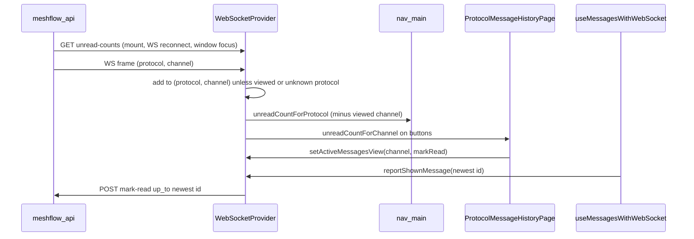

# Messages UI — unread count

**Purpose:** Sidebar **Messages** badges (per protocol), per-channel badges on the messages page, and read marking.

**API counterpart:** [meshflow-api `docs/features/text-messages/unread-count.md`](https://github.com/pskillen/meshflow-api/blob/main/docs/features/text-messages/unread-count.md); endpoints from [meshflow-api#527](https://github.com/pskillen/meshflow-api/pull/527).

**Broader UI context:** [architecture.md](../../messages/architecture.md), [gaps-and-roadmap.md](../../messages/gaps-and-roadmap.md).

**Tracking:** [#422](https://github.com/pskillen/meshflow-ui/issues/422) (supersedes [#324](https://github.com/pskillen/meshflow-ui/issues/324); earlier work [#279](https://github.com/pskillen/meshflow-ui/issues/279)). Deferred rollup: [meshflow-api#396](https://github.com/pskillen/meshflow-api/issues/396).

---

## Product behaviour

- **Off the messages pages:** each protocol's Messages nav badge = total unread for that protocol. Meshtastic and MeshCore are independent.
- **On a messages page:** only the channel being viewed is read. The nav badge = that protocol's unread minus the viewed channel; other channels keep their counts. The other protocol is unaffected.
- **Reload / tab closed:** counts come from the API (per-user read cursors), so they survive reload and include messages that arrived while the tab was closed.
- **Nav click:** plain navigation, clears nothing.
- Badges show `9+` above 9 and `99+` above 99 (the API caps each channel at 99).

| Surface                            | Count                                | Cleared when                                          |
| ---------------------------------- | ------------------------------------ | ----------------------------------------------------- |
| Sidebar Messages link (MT / MC)    | Sum of channel counts for protocol   | Each channel is read (viewed)                         |
| Channel button row (messages page) | Unread for **protocol + channel id** | That channel is viewed (initial on mount, or clicked) |
| Viewed channel                     | Never counts, WS frames included     | n/a                                                   |

**What marks a channel read:** the initial channel when the page mounts, or a channel the user clicks. The channel auto-selected after a **constellation switch** is displayed but **not** marked read ([meshflow-api#396](https://github.com/pskillen/meshflow-api/issues/396)); it counts normally until clicked.

**Toast:** protocol-level only — fires when the user is **not** on that protocol's messages route. Sibling channels on the same page do not toast; unread badges still increment. Frames with an unknown protocol toast nowhere.

**Unknown protocol:** a WS frame whose protocol cannot be determined (no `protocol`, no MC provenance fields) counts toward neither protocol (`messageProtocolOrNull`). `messageProtocol` still defaults to Meshtastic for display/grouping only.

---

## API contract used

- `GET /api/messages/unread-counts/` → `{"meshtastic": {"total", "channels": {"<channel_id>": n}}, "meshcore": {...}}`. Channels list only unread > 0; per-channel cap 99, 7-day window. The first ever call starts the user's cursors at now.
- `POST /api/messages/channels/{id}/mark-read/` body `{"up_to": "<ISO ts | message UUID>"}` (optional, default now). Cursor never regresses.
- **404 fallback:** on an API without the endpoint, `useUnreadCountsQuery` yields `available: false`; the UI counts WS frames only (the pre-#422 behaviour, lost on reload), still excludes the viewed channel, and never calls mark-read.

---

## Code anchors

| Piece                          | Path                                                                                                                 |
| ------------------------------ | -------------------------------------------------------------------------------------------------------------------- |
| Unread state + helpers         | `src/providers/WebSocketProvider.tsx`                                                                                |
| Server counts query            | `src/hooks/api/useUnreadCounts.ts`                                                                                   |
| API calls                      | `getUnreadCounts`, `markChannelRead` in `src/lib/api/meshflow-api.ts`                                                |
| Messages page + channel badges | `src/pages/protocol/ProtocolMessageHistoryPage.tsx`                                                                  |
| Protocol derivation            | `src/lib/message-protocol.ts`                                                                                        |
| Nav badges                     | `src/components/nav-main.tsx`                                                                                        |
| WS client                      | `src/lib/websocket/websocketService.ts`                                                                              |
| On-page realtime               | `src/hooks/useMessagesWithWebSocket.ts`                                                                              |
| Tests                          | `WebSocketProvider.test.tsx`, `nav-main.test.tsx`, `ProtocolMessageHistoryPage.test.tsx`, `message-protocol.test.ts` |

---

## Data flow

### `WebSocketProvider`

- **Counts** per (protocol, channel) = server snapshot + WS frames received after that snapshot, deduped by message id, capped at 99 per channel. Protocol total = sum of channel counts.
- **Reconcile:** a fresh snapshot (WS reconnect, window focus, or first load) replaces the local WS additions, since the server already counted those frames. Refetch is `refetchOnWindowFocus: 'always'` plus a refetch on the WS `CONNECTED` event.
- **Viewed channel:** `setActiveMessagesView({ protocol, channelId, markRead })`. With `markRead` (default) the channel never counts; when the list reports the newest message shown (`reportShownMessage`), the provider zeroes the channel locally and POSTs mark-read with `up_to` = that id. New frames for the viewed channel are prepended to the list, which changes the newest id and advances the cursor again, so leaving the page does not resurrect them as unread.
- **View only applies on its protocol's page:** leaving the page ends the view.

### `ProtocolMessageHistoryPage`

- Tracks which channel the user chose (`readChannel`): the initial channel on mount and any channel click. A constellation switch clears it, so the auto-selected channel registers with `markRead: false`.

### `useMessagesWithWebSocket`

- Reports the newest message shown. No longer promotes buffered unread frames when switching channel; instead `useMessagesSuspense` refetches on mount (`refetchOnMount: 'always'`) so messages that arrived while the list was unmounted appear.

---

## Known gaps

| Gap                                                                     | Notes                                                                                                                  |
| ----------------------------------------------------------------------- | ---------------------------------------------------------------------------------------------------------------------- |
| [meshflow-api#396](https://github.com/pskillen/meshflow-api/issues/396) | Per-channel badges only for **active constellation**; constellation-level rollup                                       |
| Reconcile race                                                          | A frame arriving between the server computing a snapshot and the response landing can be missed until the next refetch |
| Mark-read chatter                                                       | One POST per new message while viewing a channel (not debounced)                                                       |
| Toast reliability                                                       | May not appear in practice — verify; log separate issue if dead                                                        |

---

## Related

- [README.md](README.md) — messages feature hub
- [meshflow-api unread-count.md](https://github.com/pskillen/meshflow-api/blob/main/docs/features/text-messages/unread-count.md)
